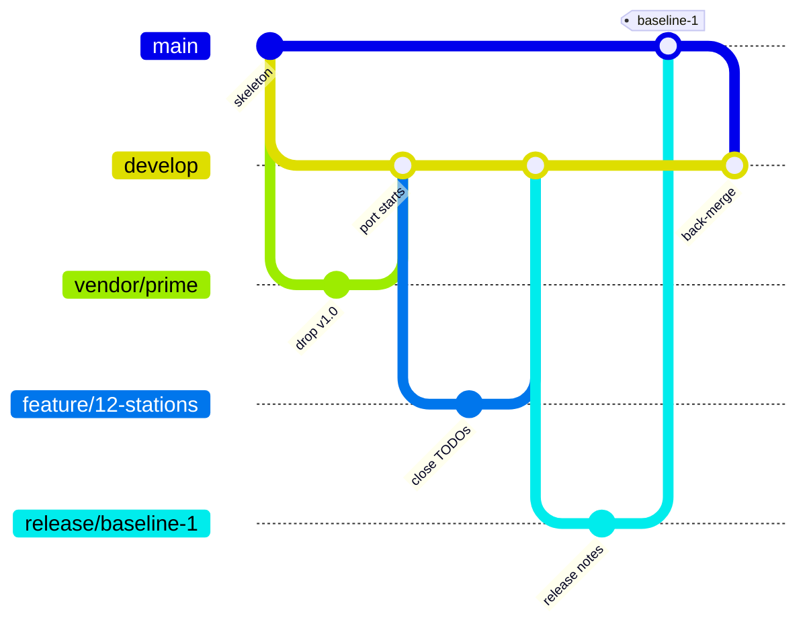

# Tidewater system model (SysML v2 text)

[[_TOC_]]

> [!note]
> Tidewater is a fictional coastal weather-observation network used to teach a model-based systems engineering
> (MBSE) process. Every name and value in this repository is notional.

This repository holds the **government's SysML v2 text model** of Tidewater. The prime contractor, Northwind Marine
Systems, keeps the authoritative SysML v1 model in Cameo and the requirements in DOORS, and delivers them as model
drops under CDRL A003. The government team ports each drop to SysML v2 text here, closes what the converter cannot
carry, and keeps the v2 model current as new drops arrive.

| Who | Role | GitLab |
|---|---|---|
| Jim | MBSE lead, responsible for the model; approves requirement changes and baselines | @jim |
| Bob | MBSE engineer | @bob |
| Tom | Configuration management engineer; runs the pipeline and the vendor branch | @tom |

## Layout

| Path | What | Who changes it |
|---|---|---|
| `model/library/` | types, interfaces and the government's conventions (`library/conventions/`) | Bob, by MR; interfaces need Jim too |
| `model/requirements/` | the three DOORS modules (`stakeholder/`, `system/`, `segment/`, from the ReqIF) and the Cameo copy (`model/`) | the drop intake; Jim approves |
| `model/logical/` | what the network does: the behavior, and the hand-written `GovBehavior.sysml` | Bob, by MR |
| `model/physical/` | what it is made of: one folder per segment, and `allocation/` | Bob, by MR |
| `model/analysis/`, `model/verification/` | constraints and analyses; verification cases | Jim, Bob |
| `model/legacy/` | clutter from the document port (gone after drop 6) | nobody: a DR asked the prime to delete it |
| `imports/<version>/` | each prime drop exactly as delivered, with its `MANIFEST.txt` | Tom, through `vendor/prime` |
| `docs/` | generated by `model.pl docs`; never edit by hand | the pipeline checks it |
| `.gitlab/` | issue and merge request templates | Tom |

## Branches (gitflow)



- `develop` is the default branch. Every change arrives there by merge request from a `feature/<issue>-<slug>` branch.
- `main` holds released baselines only, merged from `release/baseline-N` and tagged `baseline-N`.
- `vendor/prime` holds the raw converter output of each drop and is never edited by hand. A drop reaches `develop`
  through a `feature/drop-<version>` branch that merges it.
- `hotfix/<name>` branches fix a released baseline and merge to `main` and back to `develop`.

The full rules are in the wiki page [Gitflow](../-/wikis/Gitflow).

## Working on a story

```sh
perl $KIT/bin/gitlab.pl flow start feature 42-close-stations-todos   # from develop
# ... edit model/, then:
perl $KIT/tools/sysml/model.pl lint && perl $KIT/tools/sysml/model.pl docs
git add -A && git commit -m "Close the Stations TODO lines" -m "Closes #42"
perl $KIT/bin/gitlab.pl ci --event merge_request_event --branch feature/42-close-stations-todos --target develop
perl $KIT/bin/gitlab.pl flow finish --title "Close the Stations TODO lines" --template .gitlab/merge_request_templates/Default.md
```

## The pipeline

`check` (grammar, lint 0/0, outline, secrets, TODO count) → `trace` (DOORS against the model) → `docs` (generated
docs current) → `delta` (drop intake only) → `release` (baseline tags only) → `report` (weekly schedule only). See
`.gitlab-ci.yml`; every job runs locally with `gitlab.pl ci`.

## New to this?

Start with the wiki pages [Glossary](../-/wikis/Glossary) (systems engineering and CM terms, and their GitLab names)
and [Onboarding](../-/wikis/Onboarding).

## Getting help

- Process questions: the wiki ([Home](../-/wikis/Home)).
- A problem in the v2 model: open an issue with the **Defect** template.
- A problem in the prime's v1 model or DOORS: open an issue with the **Discrepancy Report** template; Jim sends it to
  the prime.
