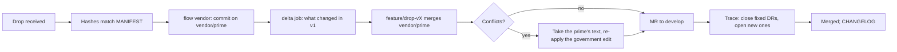

# Drop Intake Runbook

A prime drop is the prime contractor's CDRL delivery of its v1 model: an XMI export of the Cameo model, a ReqIF and a CSV export of DOORS, and a `MANIFEST.txt`, delivered
under CDRL A003. Intake is one story (template **Prime Drop**), owned by @tom, finished in the sprint it arrives.



## Steps

1. **Receive.** Put the files in a dated folder outside the repo. Check them:
   ```sh
   cd /secure/drops/2027-01-08 && sha256sum -c MANIFEST.sha256   # or compare with the hashes in MANIFEST.txt
   ```
2. **Open the intake issue** from the *Prime Drop* template in the current sprint.
3. **Import on the vendor branch.** From a clean clone:
   ```sh
   perl $KIT/bin/gitlab.pl flow vendor /secure/drops/2027-01-08 v1.1
   ```
   This converts the drop (`xmi2sysml.pl`, `reqif2sysml.pl`), replaces `model/` and adds `imports/v1.1/` on
   `vendor/prime`, pushes it, then starts `feature/drop-v1.1` from `develop` and merges `vendor/prime` into it. It lists
   any conflicted files.
4. **Read the delta.** The vendor pipeline's `delta` job (artifact `delta.txt`) lists what the prime added, removed and
   changed in v1. A line marked **manual** is something the converter does not carry (a state machine, an interaction,
   a constraint expression): add a task for each.
5. **Resolve conflicts.** For each file: take the prime's version, then re-apply the government's edit on top.
   ```sh
   git checkout --theirs model/analysis/Analysis.sysml   # the prime's text
   # re-apply the closed TODO / level tags, then:
   git add model/analysis/Analysis.sysml && git commit
   ```
6. **Open the MR** with the *Prime Drop* template; paste the delta summary and the conflict table.
7. **Trace.** The `trace` job shows linked, orphan, unverified and drifted requirements. Close the DRs this drop fixes;
   open new ones for what it breaks.
8. **File the drop.** The vendor pipeline's `drop-package` job puts the delivered files in the project's package
   registry (Deploy > Package registry > `prime-drop`, version `v1.1`): the deliverable kept with what it became.
9. **Merge**, update `CHANGELOG.md`, close the intake issue.

> [!warning]
> Never edit `vendor/prime` by hand. If a drop is wrong, raise a DR and wait for the next drop; the vendor branch must
> always be exactly "what the converter makes of what the prime delivered".
