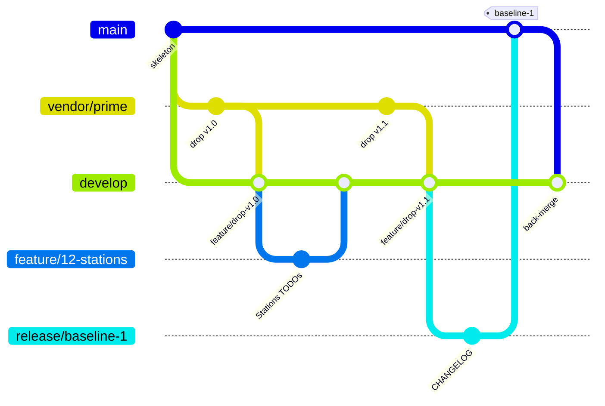

# Gitflow

[[_TOC_]]

Gitflow is the set of rules for how changes move between working copies, the master copy and the released baselines.
If you have run configuration management, you know the ideas; only the names are new:

| You know | In gitflow |
|---|---|
| The controlled master copy | `develop` |
| Released baselines | `main`, where each baseline is a tag `baseline-N` |
| A working copy for one change | a feature branch, `feature/<issue>-<what>` |
| Preparing a baseline for release | a release branch, `release/baseline-N` |
| An urgent correction to a released baseline | a hotfix branch, `hotfix/<what>` |
| The contractor's deliveries, kept as received | `vendor/prime` |
| Incorporating an approved change | a merge, through a merge request |

## Branches

| Branch | From | Into | Who pushes | Who merges | Lives |
|---|---|---|---|---|---|
| `main` | | | nobody | maintainers (Jim, Tom) | forever; baselines only |
| `develop` | `main` | | nobody | developers, after approval | forever; the default branch |
| `feature/<iid>-<slug>` | `develop` | `develop` | its author | | until merged (deleted) |
| `release/baseline-N` | `develop` | `main` | maintainers | maintainers | days |
| `hotfix/<name>` | `main` | `main`, then `develop` | maintainers | maintainers | hours |
| `vendor/prime` | first commit | `develop` (through `feature/drop-*`) | Tom only | nobody | forever; never hand-edited |

Tags `baseline-N` are protected: only maintainers create them, nobody moves or deletes them.

## The picture



## Why gitflow here

- The model is **released** as baselines that analyses cite; `main` is exactly the list of those baselines.
- Day-to-day work never waits on a release: it keeps merging into `develop`.
- The prime's drops come in on their own branch, so git's three-way merge carries the government's edits (closed TODO
  lines, level tags) across every new drop. Conflicts appear only where both sides changed the same lines.

## Commands

```sh
perl $KIT/bin/gitlab.pl flow start feature 42-close-stations-todos
perl $KIT/bin/gitlab.pl flow publish
perl $KIT/bin/gitlab.pl flow finish --title "Close the Stations TODO lines"
perl $KIT/bin/gitlab.pl flow start release baseline-1
perl $KIT/bin/gitlab.pl flow finish --template .gitlab/merge_request_templates/Release.md
perl $KIT/bin/gitlab.pl flow vendor /secure/drops/2027-01-08 v1.1
perl $KIT/bin/gitlab.pl flow sync
```
