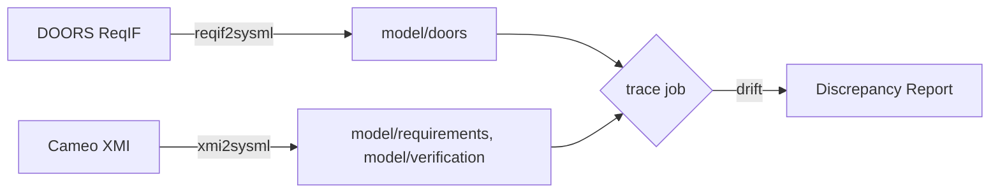

# Decision: requirements come from DOORS, relationships from Cameo

[[_TOC_]]

| | |
|---|---|
| Status | **Accepted** (Sprint 3, 2026-11-06) |
| Decided by | @jim |
| Spike | #14 |
| Affects | `model/requirements/`, `model/doors/`, the `trace` job |

## Context

Each prime drop carries the requirements twice: in DOORS (ReqIF, CSV) and inside the Cameo model (XMI), synchronized by
the prime's DOORS plug-in. Both converters emit them, named by DOORS id (`TW_SYS_001`). The two copies can drift: in
drop v1.0, TW-SYS-006 already differs[^1].

## Decision

1. **DOORS is the requirements authority.** `reqif2sysml.pl` output goes to `model/doors/<module>/`.
2. **Cameo is the relationships authority.** Satisfy, verify and derive relationships come from the XMI conversion in
   `model/requirements/` and `model/verification/`.
3. The `trace` job compares the two on every MR and reports drift; drift is a discrepancy report, never a hand edit.

## Consequences

- No government edits to requirement text, ever: the vendor branch keeps both copies exactly as delivered.
- The model has two definitions per requirement (one per package); analyses cite `model/doors/`.

[^1]: DR-3 (#10): "twice a day" is in DOORS only.
